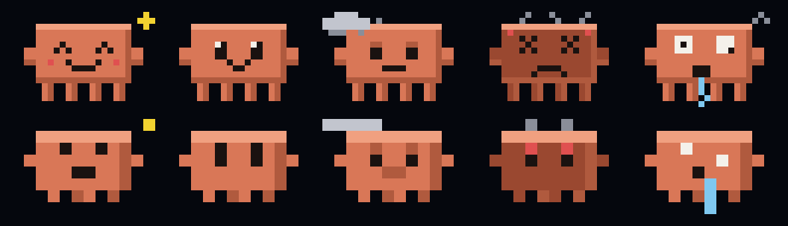

# clawd-meter

A Claude Code mod that puts a small pixel-art mascot, a fan-made take on the orange
Claude mascot, right-aligned in the band above the prompt. Its expression follows how full
the context window is, on the same scale as
[claude-compact-statusline](https://github.com/Aypex-agent/claude-compact-statusline):

| Context used | Band     |
|-------------:|----------|
| under 40%    | sharp    |
| 40 to 60%    | coasting |
| 60 to 75%    | foggy    |
| 75 to 90%    | cooked   |
| 90% and up   | dumb     |



## Install

At the prompt of a Claude Code terminal session:

```
/plugin install clawd-meter --marketplace Aypex-agent/clawd-meter
```

Answer `y` to add the marketplace, then pick a scope (user is first). From a shell:

```sh
claude plugin install clawd-meter --marketplace Aypex-agent/clawd-meter
```

In the desktop app, where `/plugin` does not run: click + next to the prompt box, then Plugins,
then Add marketplace with `Aypex-agent/clawd-meter`, then Add plugin.

The band can be collapsed with its `[-]` button or **Ctrl+X Ctrl+A**; the same keys bring it back.

## Rendering

- **Ghostty and kitty** (`TERM` contains `ghostty` or `kitty`): a real PNG through the kitty
  graphics protocol. The 24x16 sprite is stored upscaled 8x with nearest-neighbour scaling,
  so it stays crisp.
- **Everything else, foot included:** a 12x8 sprite drawn as half-block (`▀`) truecolor cells.
- Force either one with `CLAWD_METER_MODE=image` or `CLAWD_METER_MODE=raster`.

The band is 12 columns by 4 rows. With the compact statusline, set `PHONE_SL_FACE=0` so the
ASCII face isn't shown twice.

## Editing the art

The sprites are drawn in code in `tools/make_sprites.py` (standard library only). Change them
there and run `python3 tools/make_sprites.py`. That rebuilds `assets/*.png`, `assets/preview.png`
and `hooks/sprites.ts`, which holds the PNGs and Raster cells the mod embeds.

## License

MIT. Fan art; not affiliated with Anthropic.
